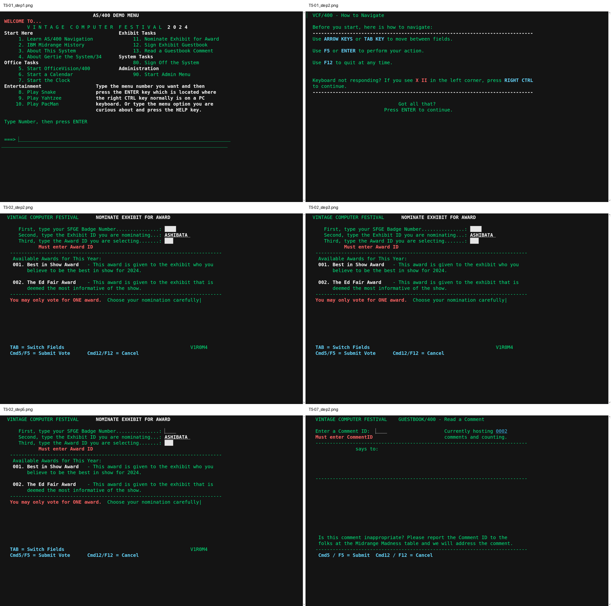
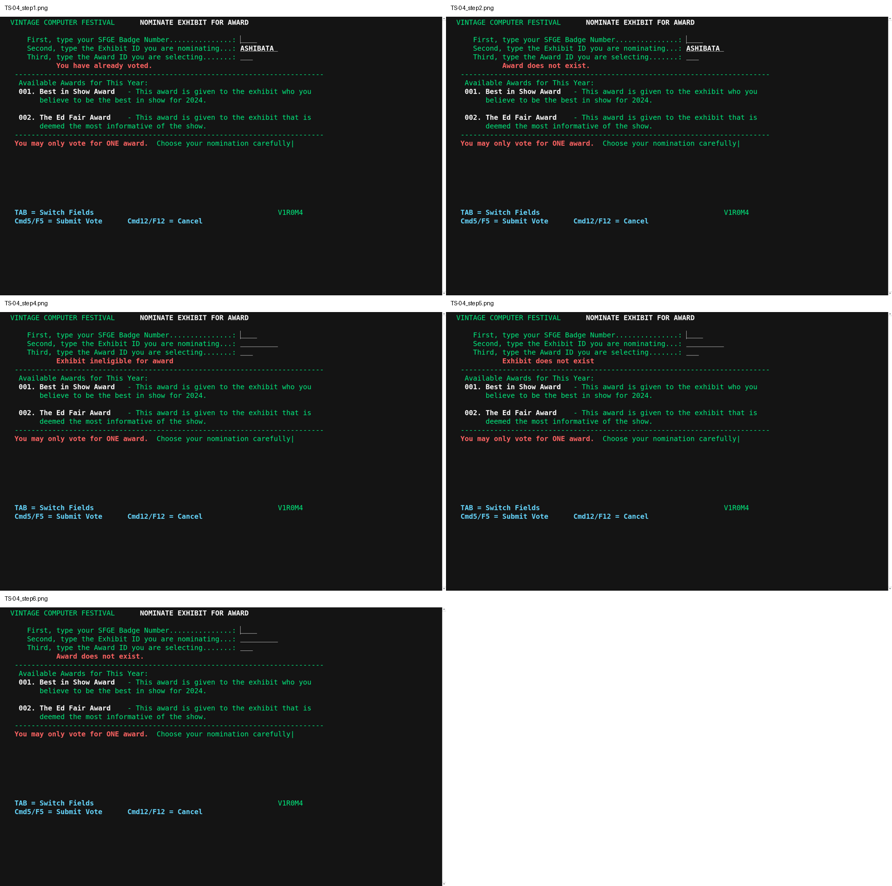
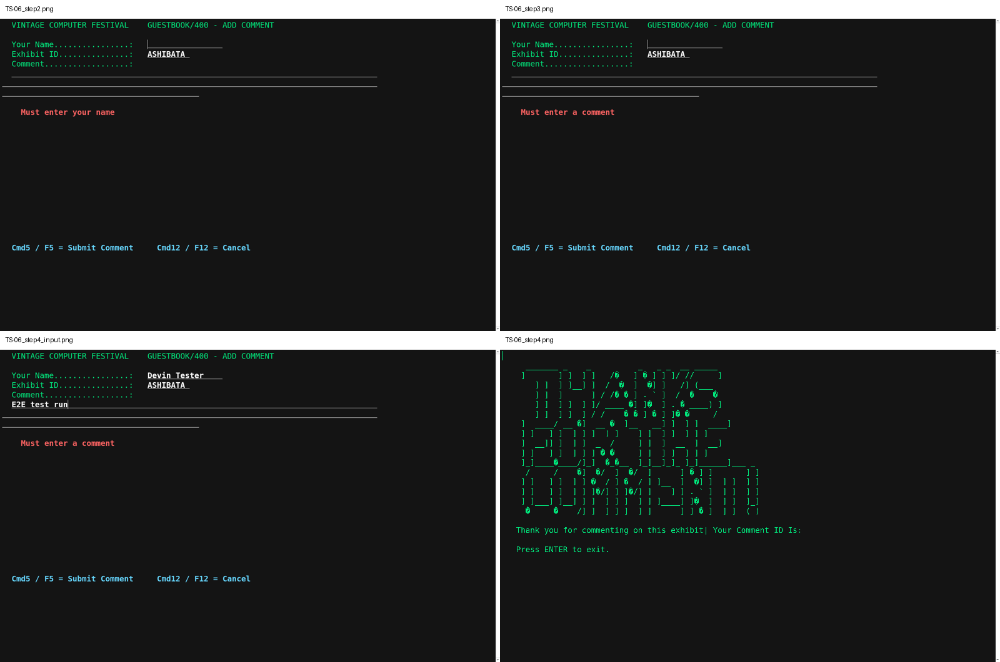
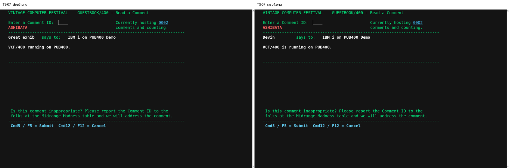
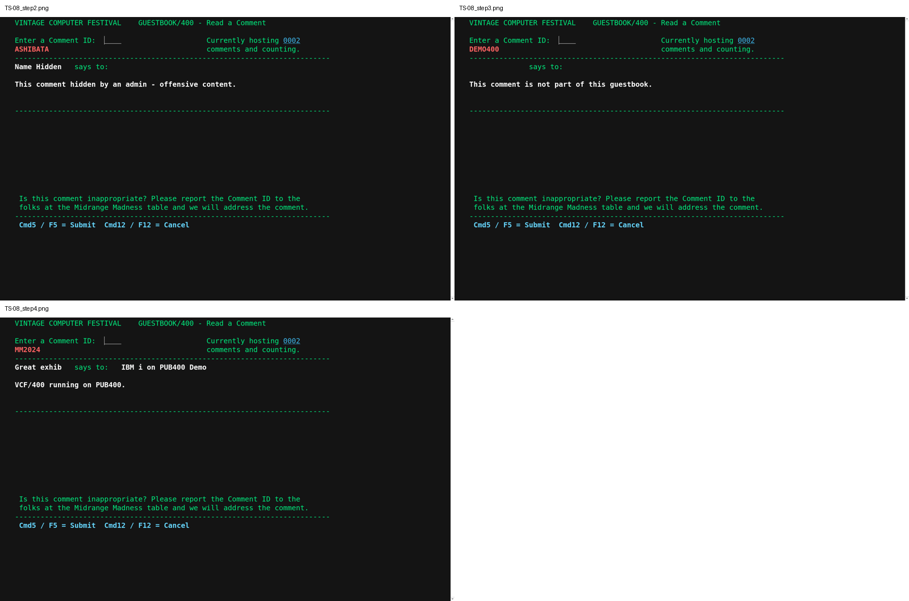
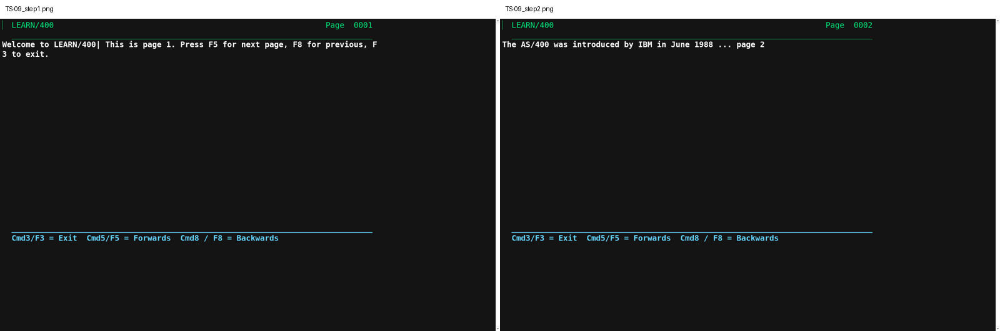
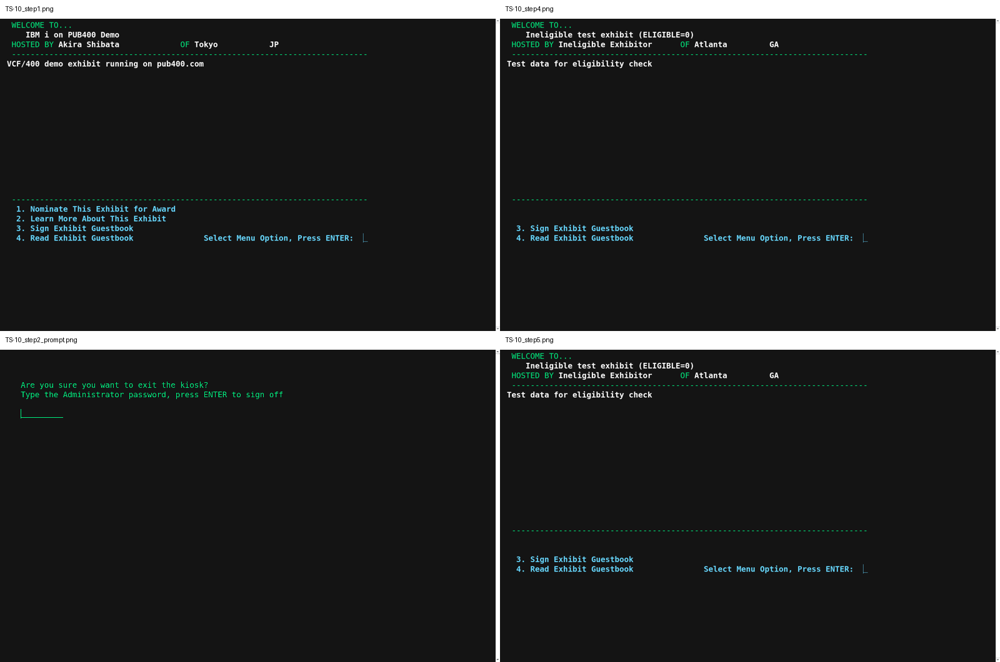

# VCF400 PUB400 5250 E2E 統合テストレポート

## 1. 概要

- **対象**: madmerger/VCF400 の master ソース (RPG IV / CL / DDS) を 2026-10-14 に PUB400 のライブラリ ASHIBATA2 へソースから再ビルドしたもの
- **実行環境**: PUB400 (pub400.com) 5250 端末接続 (tn5250 / telnet:23)。DB 検証は SSH 2222 の PASE `db2`
- **根拠仕様**: DeepWiki (madmerger/VCF400) — 3 Kiosk Application Flow / 3.1 EXHBMENU / 3.2 Menus and CL Stubs / 4.1 Casting a Vote / 5.1 Adding Comments / 5.2 Reading and Moderating Comments / 6.1 LEARN/400 Runtime
- **総合結果**: 10/10 シナリオ PASS (オリジナルステップ 50 件 + 補助確認 6 件、画面証跡 56 件)
- モック・別実装・ローカル DB は不使用。実 RPG プログラムに対して実施。

## 2. ビルド結果サマリ (2026-10-14, ASHIBATA2)

| 種別 | オブジェクト | 件数 | 結果 |
|---|---|---|---|
| *PGM (RPG/CL) | ADDGBCMT ADDGBSTUB ADDVOTE ADMADDSOFR ADMCRTEXHB ADMHIDECMT ADMLRN400 ADMOFRLIST ADMSETTING ADMVOTERPT CREDITS EXHBMENU LRN400 LRN400AUT LRN400STUB NTRSTIT PARAMETER PRTLSTCMT PRTLSTVOTE READGBCMT READGBSTUB VCFSTUB VOTESTUB | 23 | 全件 OK |
| *FILE (DSPF/PRTF) | ADMMAIN ADMSCR ADMVOTERES BMOVSCR CMTPRTF CMTTST CREDITSSCR EXHBMENUSC GUESTBKSCR INTERSCR LRN400SCR LRNAUTO MAIN PASSSCR SETUPSCR TESTPRT2 TESTSUITE VCFMAIN VOTEPRTF VOTESCR | 20 | 全件 OK |
| *MENU | ADMMAIN MAIN VCFMAIN | 3 | 全件 OK |
| *CMD | STRCMTEDT STREXHB STREXHBEDT STRVOTERPT | 4 | 全件 OK |
| *MSGF | ADMMAINQQ MAINQQ VCFMAINQQ | 3 | 全件 OK |

ASHIBATA2 オブジェクト総数 62 (*CMD:4 / *FILE:29 / *MENU:3 / *MSGF:3 / *PGM:23)。本ビルドで再作成されたオブジェクトの作成日時はすべて 26-10-14 (53 件)。データ PF (VOTINGDB 等) は CHKOBJ で既存保持。無関係オブジェクト (PF ASHIBATA 等) は未変更。

## 3. 基本機能シナリオ一覧 (10 件)

| ID | 機能 | DeepWiki 根拠 | 結果 |
|---|---|---|---|
| TS-01 | メインメニュー表示と遷移 | 3.2 | PASS |
| TS-02 | 投票の入力必須 | 4.1 (VOTE1 / 入力検証) | PASS |
| TS-03 | 投票の正常登録 | 4.1 (ADDTODB, CHECKOK=4, VOTEEND) | PASS |
| TS-04 | 投票の業務チェック | 4.1 (4 チェック) | PASS |
| TS-05 | 投票期間終了 | 4.1 (CHKALWVOTE → ENDOFCON) | PASS |
| TS-06 | ゲストブック記入 | 5.1 | PASS |
| TS-07 | ゲストブック閲覧 | 5.2 | PASS |
| TS-08 | 可視性・帰属制御 | 5.2 (VISIBLE='N', EXHBID≠USERPRF) | PASS |
| TS-09 | LEARN/400ページ送り | 6.1 | PASS |
| TS-10 | 展示キオスク | 3 / 3.1 | PASS |

## 4. シナリオ詳細

### TS-01 メインメニュー表示と遷移 — PASS

| ステップ | 操作 | 期待値 | 実際 (抜粋・証跡) | 判定 |
|---|---|---|---|---|
| 1 | サインイン → `GO ASHIBATA2/VCFMAIN` | AS/400 DEMO MENU、WELCOME TO...、祭典名と11/12/13/80/90を表示 | L1: AS/400 DEMO MENU L2: WELCOME TO... L5: 1. Learn AS/400 Navigation              11. Nominate Exhibit for Award L6: 2. IBM Midrange History                 12. Sign Exhibit Guestbook L7: 3. About This System                    13. Read a Guestbook Comment L8: 4. About Gertie the System/34      System Tasks 証跡: `results/screens/TS-01_step1.txt` | PASS |
| 2 | `11` + Enter | VCF/400 - How to Navigate、F5/ENTERとF12の説明 | L1: VCF/400 - How to Navigate L3: Before you start, here is how to navigate: L16: Got all that? L17: Press ENTER to continue. 証跡: `results/screens/TS-01_step2.txt` | PASS |
| 3 | Enter → 期待: VOTE1 `NOMINATE EXHIBIT FOR AWARD` が表示 | VOTE1のNOMINATE EXHIBIT FOR AWARD | L1: VINTAGE COMPUTER FESTIVAL      NOMINATE EXHIBIT FOR AWARD 証跡: `results/screens/TS-01_step3.txt` | PASS |
| 4 | F12 → 期待: VCFMAIN に戻る | VCFMAINへ戻る | L5: 1. Learn AS/400 Navigation              11. Nominate Exhibit for Award L6: 2. IBM Midrange History                 12. Sign Exhibit Guestbook L7: 3. About This System                    13. Read a Guestbook Comment L8: 4. About Gertie the System/34      System Tasks L10: 5. Start OfficeVision/400          Administration L11: 6. Start a Calendar                     90. Start Admin Menu 証跡: `results/screens/TS-01_step4.txt` | PASS |

### TS-02 投票の入力必須 — PASS

| ステップ | 操作 | 期待値 | 実際 (抜粋・証跡) | 判定 |
|---|---|---|---|---|
| 1 | VCFMAIN 11 → Enter (NTRSTIT) → VOTE1 | 展示ID ASHIBATAが事前入力・保護表示 | L1: VINTAGE COMPUTER FESTIVAL      NOMINATE EXHIBIT FOR AWARD L3: First, type your SFGE Badge Number...............: 証跡: `results/screens/TS-02_step1.txt` | PASS |
| 1_protection | 補助確認 | Tabは保護展示IDを飛ばしアワード欄へ移動 | L1: Tab後カーソル=[4, 57]。展示ID ASHIBATAは保護され入力対象外。 証跡: `results/screens/TS-02_step1_protection.txt` | PASS |
| 2 | 全項目空で F5 → 期待: 画面 VOTE1 のまま、エラー行 `Must enter Award ID` (最後に失敗したチェックが表示される) | 空欄送信はMust enter Award ID | L6: Must enter Award ID 証跡: `results/screens/TS-02_step2.txt` | PASS |
| 3 | バッジ `7001`、アワード空で F5 → 期待: `Must enter Award ID` | バッジ7001・アワード空はMust enter Award ID | L6: Must enter Award ID 証跡: `results/screens/TS-02_step3.txt` | PASS |
| 4 | バッジ空、アワード `1` で F5 → 期待: `Must enter badge number` | バッジ空・アワード1はMust enter badge number | L6: Must enter badge number 証跡: `results/screens/TS-02_step4.txt` | PASS |
| 5 | バッジ `7002`、アワード `0` で F5 → 期待: `Must enter Award ID` (数値 0 は未入力扱い) | バッジ7002・アワード0はMust enter Award ID | L6: Must enter Award ID 証跡: `results/screens/TS-02_step5.txt` | PASS |
| 5_input_badge | 補助確認 | バッジ7002入力済み | L1: VINTAGE COMPUTER FESTIVAL      NOMINATE EXHIBIT FOR AWARD L3: First, type your SFGE Badge Number...............: 7002 証跡: `results/screens/TS-02_step5_input_badge.txt` | PASS |
| 6 | F12 で終了 → DB: VOTINGDB はベースライン 2 件のまま | F12復帰・VOTINGDBはベースライン2件 | L5: 1. Learn AS/400 Navigation              11. Nominate Exhibit for Award L6: 2. IBM Midrange History                 12. Sign Exhibit Guestbook L7: 3. About This System                    13. Read a Guestbook Comment L8: 4. About Gertie the System/34      System Tasks L10: 5. Start OfficeVision/400          Administration L11: 6. Start a Calendar                     90. Start Admin Menu 証跡: `results/screens/TS-02_step6.txt` | PASS |

DB 件数 (before → after): VOTINGDB: 2 → 2 件; GUESTBKDB: 2 → 2 件

### TS-03 投票の正常登録 — PASS

| ステップ | 操作 | 期待値 | 実際 (抜粋・証跡) | 判定 |
|---|---|---|---|---|
| 1 | VCFMAIN 11 → VOTE1、バッジ `7001`、アワード `1` で F5 | VOTEEND、THANK YOUアートとYour vote has been RECORDED! | ASCIIアートのグリフ差は機能影響なし、コードページ差。リードからの判定方針によりVOTEEND識別・業務テキスト(!正規化)・DBで機能判定。 証跡: `results/screens/TS-03_step1.txt` | PASS |
| 1_input | 補助確認 | バッジ7001・アワード001を入力済み | L1: VINTAGE COMPUTER FESTIVAL      NOMINATE EXHIBIT FOR AWARD L3: First, type your SFGE Badge Number...............: 7001 証跡: `results/screens/TS-03_step1_input.txt` | PASS |
| 2 | Enter → VCFMAIN に戻る | EnterでVCFMAINへ戻る | L5: 1. Learn AS/400 Navigation              11. Nominate Exhibit for Award L6: 2. IBM Midrange History                 12. Sign Exhibit Guestbook L7: 3. About This System                    13. Read a Guestbook Comment L8: 4. About Gertie the System/34      System Tasks L10: 5. Start OfficeVision/400          Administration L11: 6. Start a Calendar                     90. Start Admin Menu 証跡: `results/screens/TS-03_step2.txt` | PASS |
| 3 | DB: VOTINGDB に (BADGENBR=7001, AWARDNBR=1, EXHBNBR='ASHIBATA') が追加され計 3 件 | DBに(7001,1,ASHIBATA)追加、合計3件 | L2: BADGENBR  AWARDNBR  EXHBNBR L4: 1         1 ASHIBATA 証跡: `results/screens/TS-03_step3.txt` | PASS |

DB 件数 (before → after): VOTINGDB: 2 → 3 件; GUESTBKDB: 2 → 2 件

### TS-04 投票の業務チェック — PASS

| ステップ | 操作 | 期待値 | 実際 (抜粋・証跡) | 判定 |
|---|---|---|---|---|
| 1 | VCFMAIN 11、バッジ `1` (既存)、アワード `2` で F5 → 期待: `You have already voted.` | 既存バッジ1・アワード2はYou have already voted. | L6: You have already voted. 証跡: `results/screens/TS-04_step1.txt` | PASS |
| 2 | 同画面でバッジ `7002`、アワード `9` で F5 → 期待: `Award does not exist.` | バッジ7002・アワード9はAward does not exist. | L6: Award does not exist. 証跡: `results/screens/TS-04_step2.txt` | PASS |
| 3 | F12 → コマンドラインで `CALL ASHIBATA2/ADDVOTE PARM('MM2024')` (共用端末: 展示 ID 入力可) | 共用端末では展示ID入力可 | L1: VINTAGE COMPUTER FESTIVAL      NOMINATE EXHIBIT FOR AWARD L3: First, type your SFGE Badge Number...............: 証跡: `results/screens/TS-04_step3.txt` | PASS |
| 4 | バッジ `7002`、展示 `NOVOTE`、アワード `1` で F5 → 期待: `Exhibit ineligible for award` | NOVOTEはExhibit ineligible for award | L6: Exhibit ineligible for award 証跡: `results/screens/TS-04_step4.txt` | PASS |
| 4_input | 補助確認 | 7002/NOVOTE/001を入力済み | L1: VINTAGE COMPUTER FESTIVAL      NOMINATE EXHIBIT FOR AWARD L3: First, type your SFGE Badge Number...............: 7002 証跡: `results/screens/TS-04_step4_input.txt` | PASS |
| 5 | 展示を `NOSUCH` に変えて F5 → 期待: `Exhibit does not exist` | 展示NOSUCHはExhibit does not exist | L6: Exhibit does not exist 証跡: `results/screens/TS-04_step5.txt` | PASS |
| 6 | バッジ `1`、展示 `NOSUCH`、アワード `9` で F5 → 期待: `Award does not exist.` (複数違反時は最後のチェック = アワードが勝つ) | 複数違反時は最後のAward does not exist. | L6: Award does not exist. 証跡: `results/screens/TS-04_step6.txt` | PASS |
| 7 | F12 → DB: VOTINGDB はベースライン 2 件のまま (書込なし) | F12復帰、投票DBはベースライン2件で書込なし | L2: BADGENBR  AWARDNBR  EXHBNBR L4: 1         1 ASHIBATA 証跡: `results/screens/TS-04_step7.txt` | PASS |

DB 件数 (before → after): VOTINGDB: 2 → 2 件; GUESTBKDB: 2 → 2 件

### TS-05 投票期間終了 — PASS

| ステップ | 操作 | 期待値 | 実際 (抜粋・証跡) | 判定 |
|---|---|---|---|---|
| 1 | 事前: SETTINGS.ALWVOTE を 'N' に更新 | ALWVOTE=Nに更新 | L1: DB20000I  THE SQL COMMAND COMPLETED SUCCESSFULLY. 証跡: `results/screens/TS-05_step1.txt` | PASS |
| 2 | VCFMAIN 11 → Enter (NTRSTIT) | VOTE1を表示せずENDOFCON、The voting period has ended and you can no longer vote. | L8: The voting period has ended and you can no longer vote. L14: Press ENTER to exit. 証跡: `results/screens/TS-05_step2.txt` | PASS |
| 3 | Enter → VCFMAIN に戻る | EnterでVCFMAINへ戻る | L5: 1. Learn AS/400 Navigation              11. Nominate Exhibit for Award L6: 2. IBM Midrange History                 12. Sign Exhibit Guestbook L7: 3. About This System                    13. Read a Guestbook Comment L8: 4. About Gertie the System/34      System Tasks L10: 5. Start OfficeVision/400          Administration L11: 6. Start a Calendar                     90. Start Admin Menu 証跡: `results/screens/TS-05_step3.txt` | PASS |
| 4 | 事後: ALWVOTE を 'Y' に戻す。DB: VOTINGDB は 2 件のまま | ALWVOTE=Y復旧、VOTINGDB2件 | L2: BADGENBR  AWARDNBR  EXHBNBR L4: 1         1 ASHIBATA 証跡: `results/screens/TS-05_step4.txt` | PASS |

DB 件数 (before → after): VOTINGDB: 2 → 2 件; GUESTBKDB: 2 → 2 件

### TS-06 ゲストブック記入 — PASS

| ステップ | 操作 | 期待値 | 実際 (抜粋・証跡) | 判定 |
|---|---|---|---|---|
| 1 | VCFMAIN 12 → Enter (NTRSTIT) → ADDCMT `GUESTBOOK/400 - ADD COMMENT`、展示 ID `ASHIBATA` が保護表示 | GUESTBOOK/400 - ADD COMMENT、展示ID ASHIBATA保護表示 | L1: VINTAGE COMPUTER FESTIVAL    GUESTBOOK/400 - ADD COMMENT 証跡: `results/screens/TS-06_step1.txt` | PASS |
| 2 | 名前空、コメント `Hello` で F5 → 期待: `Must enter your name` | 名前空・コメントHelloはMust enter your name | L10: Must enter your name 証跡: `results/screens/TS-06_step2.txt` | PASS |
| 3 | 名前 `Devin Tester`、コメント空で F5 → 期待: `Must enter a comment` | 名前Devin Tester・コメント空はMust enter a comment | L10: Must enter a comment 証跡: `results/screens/TS-06_step3.txt` | PASS |
| 4 | 名前 `Devin Tester`、コメント `E2E test run` で F5 → 期待: ENDCMT (THANK YOU FOR COMMENTING アスキーアート) | ENDCMT、THANK YOU FOR COMMENTINGアート | L19: Thank you for commenting on this exhibit\| Your Comment ID Is: L21: Press ENTER to exit. 証跡: `results/screens/TS-06_step4.txt` | PASS |
| 4_input | 補助確認 | 名前Devin Tester・コメントE2E test run | L3: Your Name................:   Devin Tester L6: E2E test run L10: Must enter a comment 証跡: `results/screens/TS-06_step4_input.txt` | PASS |
| 5 | Enter → VCFMAIN | EnterでVCFMAIN復帰 | L5: 1. Learn AS/400 Navigation              11. Nominate Exhibit for Award L6: 2. IBM Midrange History                 12. Sign Exhibit Guestbook L7: 3. About This System                    13. Read a Guestbook Comment L8: 4. About Gertie the System/34      System Tasks L10: 5. Start OfficeVision/400          Administration L11: 6. Start a Calendar                     90. Start Admin Menu 証跡: `results/screens/TS-06_step5.txt` | PASS |
| 6 | DB: GUESTBKDB に CMTID=3 (既存最大 2 + 1)、VISIBLE='Y'、EXHBID='ASHIBATA'、GUESTNAME='Devin Tester'、GUESTCMT='E2E test run' | CMTID=3、VISIBLE=Y、EXHBID=ASHIBATA、Devin Tester/E2E test runを登録 | L1: VISIBLE  EXHBID    GUESTNAME            GUESTCMT L3: 1 Y        ASHIBATA  Great exhibit        VCF/400 running on PUB400. 証跡: `results/screens/TS-06_step6.txt` | PASS |

DB 件数 (before → after): VOTINGDB: 2 → 2 件; GUESTBKDB: 2 → 3 件
追加行: `3 Y        ASHIBATA  Devin Tester         E2E test run`

### TS-07 ゲストブック閲覧 — PASS

| ステップ | 操作 | 期待値 | 実際 (抜粋・証跡) | 判定 |
|---|---|---|---|---|
| 1 | VCFMAIN 13 → Enter (NTRSTIT) → READCMT。総コメント数欄に `2` (最終 CMTID) | READCMT、総コメント数2 | L3: Enter a Comment ID:                          Currently hosting 0002 L6: says to: 証跡: `results/screens/TS-07_step1.txt` | PASS |
| 2 | ID 空で Enter → 期待: `Must enter CommentID` | ID空EnterはMust enter CommentID | L4: Must enter CommentID                         comments and counting. L3: Enter a Comment ID:                          Currently hosting 0002 L6: says to: 証跡: `results/screens/TS-07_step2.txt` | PASS |
| 3 | ID `0001` (4 桁入力、Field Exit 不要) で Enter | Great exhib / IBM i on PUB400 Demo / VCF/400 running on PUB400. | L3: Enter a Comment ID:                          Currently hosting 0002 L6: Great exhib   says to:   IBM i on PUB400 Demo 証跡: `results/screens/TS-07_step3.txt` | PASS |
| 4 | 再度 VCFMAIN 13、ID `9999` → 期待: 末尾超えのため最終レコード (ID 2) にフォールバック: 名前 `Devin`、コメント `VCF/400 is running on PUB400.` | 末尾超えはID2にフォールバック、Devin / VCF/400 is running on PUB400. | L3: Enter a Comment ID:                          Currently hosting 0002 L6: Devin         says to:   IBM i on PUB400 Demo 証跡: `results/screens/TS-07_step4.txt` | PASS |

### TS-08 可視性・帰属制御 — PASS

| ステップ | 操作 | 期待値 | 実際 (抜粋・証跡) | 判定 |
|---|---|---|---|---|
| 1 | 事前: GUESTBKDB ID 2 の VISIBLE を 'N' に更新 | ID2のVISIBLE=Nに更新 | L1: DB20000I  THE SQL COMMAND COMPLETED SUCCESSFULLY. 証跡: `results/screens/TS-08_step1.txt` | PASS |
| 2 | VCFMAIN 13、ID `0002` → 期待: 名前 `Name Hidden`、コメント `This comment hidden by an admin - offensive content.` | Name Hidden、This comment hidden by an admin - offensive content. | L8: This comment hidden by an admin - offensive content. L3: Enter a Comment ID:                          Currently hosting 0002 L6: Name Hidden   says to: 証跡: `results/screens/TS-08_step2.txt` | PASS |
| 3 | コマンドラインで `CALL ASHIBATA2/READGBCMT PARM('DEMO400')`、ID `0001` → 期待: 名前・タイトル空欄、コメント `This comment is not part of this guestbook.` (他展示のコメントは非公開) | 他展示は名前・タイトル空欄、This comment is not part of this guestbook. | L8: This comment is not part of this guestbook. L3: Enter a Comment ID:                          Currently hosting 0002 L6: says to: 証跡: `results/screens/TS-08_step3.txt` | PASS |
| 4 | `CALL ASHIBATA2/READGBCMT PARM('MM2024')`、ID `0001` → 期待: 共用端末は閲覧可: `Great exhib` / `IBM i on PUB400 Demo` / `VCF/400 running on PUB400.` | 共用端末ではGreat exhib / IBM i on PUB400 Demo / VCF/400 running on PUB400. | L3: Enter a Comment ID:                          Currently hosting 0002 L6: Great exhib   says to:   IBM i on PUB400 Demo 証跡: `results/screens/TS-08_step4.txt` | PASS |
| 5 | 事後: VISIBLE を 'Y' に戻す | ID2のVISIBLE=Yへ復旧 | L1: DB20000I  THE SQL COMMAND COMPLETED SUCCESSFULLY. 証跡: `results/screens/TS-08_step5.txt` | PASS |

### TS-09 LEARN/400ページ送り — PASS

| ステップ | 操作 | 期待値 | 実際 (抜粋・証跡) | 判定 |
|---|---|---|---|---|
| 1 | VCFMAIN `1` → 期待: LEARN/400 画面、ページ 1 `Welcome to LEARN/400! This is page 1. ...` | LEARN/400ページ1 Welcome to LEARN/400! This is page 1. | L3: Welcome to LEARN/400\| This is page 1. Press F5 for next page, F8 for previous, F 証跡: `results/screens/TS-09_step1.txt` | PASS |
| 2 | F5 → 期待: ページ 2 `The AS/400 was introduced by IBM in June 1988 ... page 2` | ページ2 The AS/400 was introduced by IBM in June 1988 ... page 2 | L3: The AS/400 was introduced by IBM in June 1988 ... page 2 証跡: `results/screens/TS-09_step2.txt` | PASS |
| 3 | F8 → 期待: ページ 1 に戻る | F8でページ1へ戻る | L3: Welcome to LEARN/400\| This is page 1. Press F5 for next page, F8 for previous, F 証跡: `results/screens/TS-09_step3.txt` | PASS |
| 4 | F5, F5 → 期待: ページ 3 は EXTRA='END' のためプログラム終了 → VCFMAIN | ページ3のEXTRA=ENDでVCFMAINへ終了 | L5: 1. Learn AS/400 Navigation              11. Nominate Exhibit for Award L6: 2. IBM Midrange History                 12. Sign Exhibit Guestbook L7: 3. About This System                    13. Read a Guestbook Comment L8: 4. About Gertie the System/34      System Tasks L10: 5. Start OfficeVision/400          Administration L11: 6. Start a Calendar                     90. Start Admin Menu 証跡: `results/screens/TS-09_step4.txt` | PASS |
| 5 | 再度 VCFMAIN 1 → F3 → 期待: VCFMAIN に戻る | 再起動後F3でVCFMAINへ終了 | L5: 1. Learn AS/400 Navigation              11. Nominate Exhibit for Award L6: 2. IBM Midrange History                 12. Sign Exhibit Guestbook L7: 3. About This System                    13. Read a Guestbook Comment L8: 4. About Gertie the System/34      System Tasks L10: 5. Start OfficeVision/400          Administration L11: 6. Start a Calendar                     90. Start Admin Menu 証跡: `results/screens/TS-09_step5.txt` | PASS |

### TS-10 展示キオスク — PASS

| ステップ | 操作 | 期待値 | 実際 (抜粋・証跡) | 判定 |
|---|---|---|---|---|
| 1 | `CALL ASHIBATA2/EXHBMENU PARM('ASHIBATA')` | WELCOME TO...、IBM i on PUB400 Demo、Akira Shibata、選択肢1〜4、7非表示 | L1: WELCOME TO... L2: IBM i on PUB400 Demo L3: HOSTED BY Akira Shibata             OF Tokyo           JP L20: 1. Nominate This Exhibit for Award L21: 2. Learn More About This Exhibit L22: 3. Sign Exhibit Guestbook 証跡: `results/screens/TS-10_step1.txt` | PASS |
| 2 | `7` → 期待: ADMPSWRD `Are you sure you want to exit the kiosk?`、パスワード `WRONGPW` → キオスクメニューに戻る | 誤パスワードではキオスクへ戻る | L20: 1. Nominate This Exhibit for Award L21: 2. Learn More About This Exhibit L22: 3. Sign Exhibit Guestbook L23: 4. Read Exhibit Guestbook               Select Menu Option, Press ENTER: 証跡: `results/screens/TS-10_step2.txt` | PASS |
| 2_prompt | 補助確認 | ADMPSWRD Are you sure you want to exit the kiosk? | L4: Are you sure you want to exit the kiosk? L5: Type the Administrator password, press ENTER to sign off 証跡: `results/screens/TS-10_step2_prompt.txt` | PASS |
| 3 | `7` → パスワード `VCF2024` (SETTINGS.ADMPSWRD) → 期待: キオスク終了しコマンド画面へ戻る | 正パスワードではキオスク終了、コマンド入力画面へ戻る | L5: 1. Learn AS/400 Navigation              11. Nominate Exhibit for Award L6: 2. IBM Midrange History                 12. Sign Exhibit Guestbook L7: 3. About This System                    13. Read a Guestbook Comment L8: 4. About Gertie the System/34      System Tasks L10: 5. Start OfficeVision/400          Administration L11: 6. Start a Calendar                     90. Start Admin Menu 証跡: `results/screens/TS-10_step3.txt` | PASS |
| 4 | `CALL ASHIBATA2/EXHBMENU PARM('NOVOTE')` → 期待: タイトル `Ineligible test exhibit (ELIGIBLE=0)`、オプション 1・2 は非表示、3・4 のみ表示 | NOVOTEはタイトルIneligible test exhibit (ELIGIBLE=0)、選択肢3/4のみ表示 | L2: Ineligible test exhibit (ELIGIBLE=0) L22: 3. Sign Exhibit Guestbook L23: 4. Read Exhibit Guestbook               Select Menu Option, Press ENTER: L3: HOSTED BY Ineligible Exhibitor      OF Atlanta         GA 証跡: `results/screens/TS-10_step4.txt` | PASS |
| 5 | `1` を入力 → 期待: 無視されキオスクメニューのまま (投票画面に遷移しない) | 禁止選択肢1は無視、キオスクのまま | L22: 3. Sign Exhibit Guestbook L23: 4. Read Exhibit Guestbook               Select Menu Option, Press ENTER: L2: Ineligible test exhibit (ELIGIBLE=0) L3: HOSTED BY Ineligible Exhibitor      OF Atlanta         GA 証跡: `results/screens/TS-10_step5.txt` | PASS |
| 6 | `7` → `VCF2024` で終了 | 管理者パスワードでNOVOTEキオスク終了 | L5: 1. Learn AS/400 Navigation              11. Nominate Exhibit for Award L6: 2. IBM Midrange History                 12. Sign Exhibit Guestbook L7: 3. About This System                    13. Read a Guestbook Comment L8: 4. About Gertie the System/34      System Tasks L10: 5. Start OfficeVision/400          Administration L11: 6. Start a Calendar                     90. Start Admin Menu 証跡: `results/screens/TS-10_step6.txt` | PASS |

## 5. 主要スクリーンショット

## 6. 観察事項・制約

- tn5250 `map=37` で `!→|` や ASCII アートの縦棒・バックスラッシュ等にコードページ由来のグリフ差が見られる。機能影響なし。画面テキスト・PNG は未修正で保存し、判定時のみ既知の `!→|` を正規化した。
- signoff 送信後は接続が終了するため最終画面は未取得 (機能判定の対象外)。
- スコープ外: 管理機能 (ADMMAIN 系 / VCFMAIN 90)・印刷スプール (PRTLSTVOTE/PRTLSTCMT)。全 RPG 分岐の網羅試験ではない。
- クリーンアップ: ベースライン復旧 PASS、最終 dump がベースラインと一致 = True

## 7. 証跡ファイル一覧

`deliverables/pub400_e2e/` 基準:

- `results/results.json` — シナリオ/ステップ別の期待値・実際・判定・証跡参照
- `results/screens/TS-xx_stepN.txt` — 5250 画面テキスト 56 件
- `screenshots/*.png` — 実画面スクリーンショット 63 枚
- `results/db_TS-XX_{before,after}.txt`, `results/reset_*.txt`, `results/db_final_baseline.txt` — DB 証跡
- `results/test_report.md` — 実行時レポート (原本)
- `build/build.log` / `build/objects_after.txt` / `build/seed_dump.txt` / `build/pub400_listings/` — ビルド証跡
- `video/pub400_e2e.mp4` — 日本語字幕付き編集済み録画 (約 47 秒), `video/pub400_e2e_annotations.json`
- `tools/pub400_build.sh` / `tools/pub400_db.sh` / `tools/pub400_seed.sql` / `tools/make_report.py` — 再現用ツール
