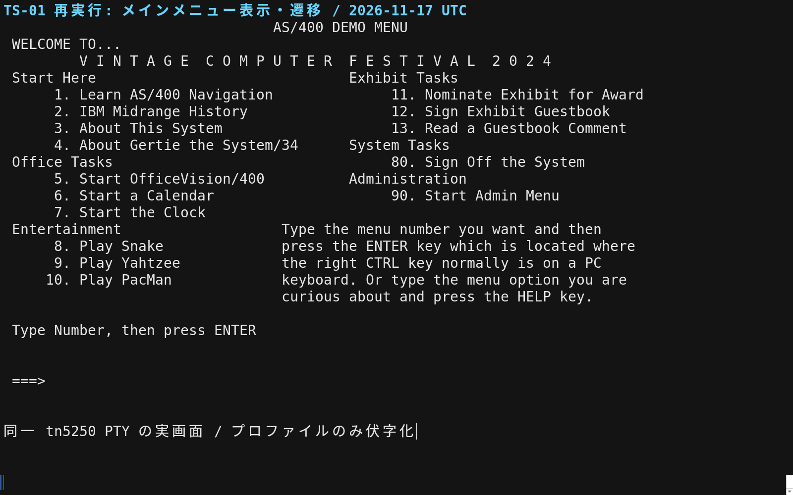
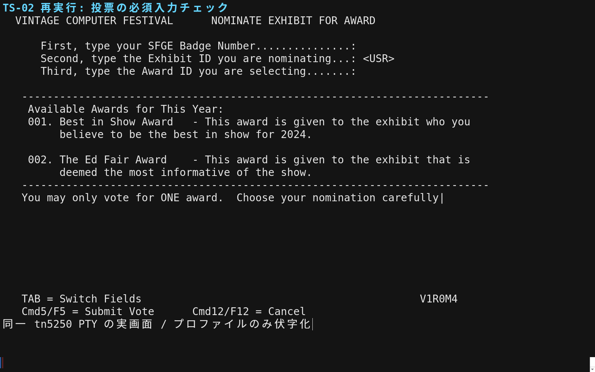
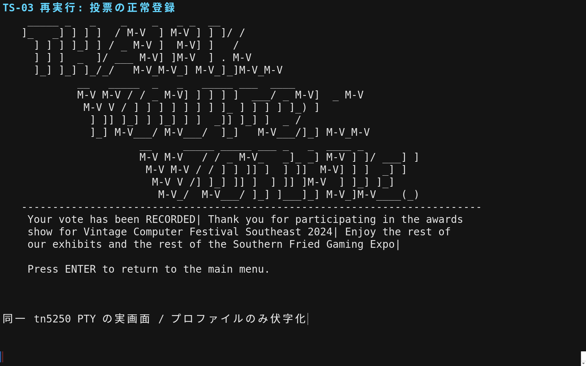
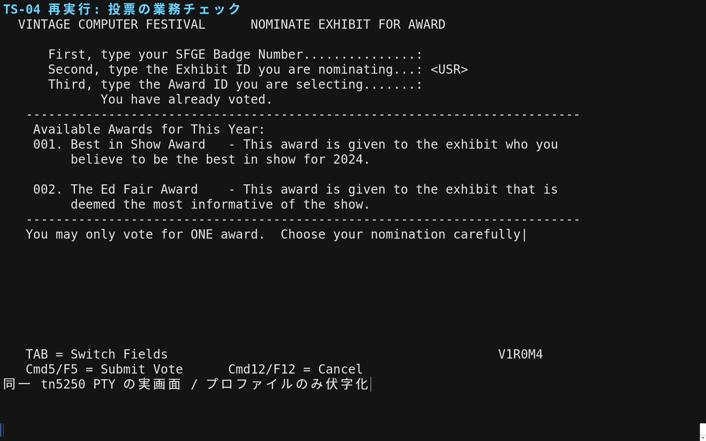
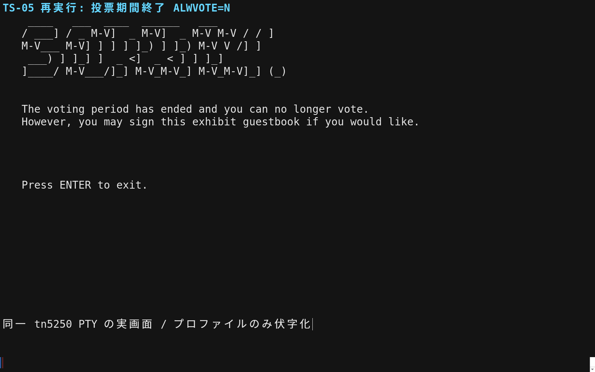
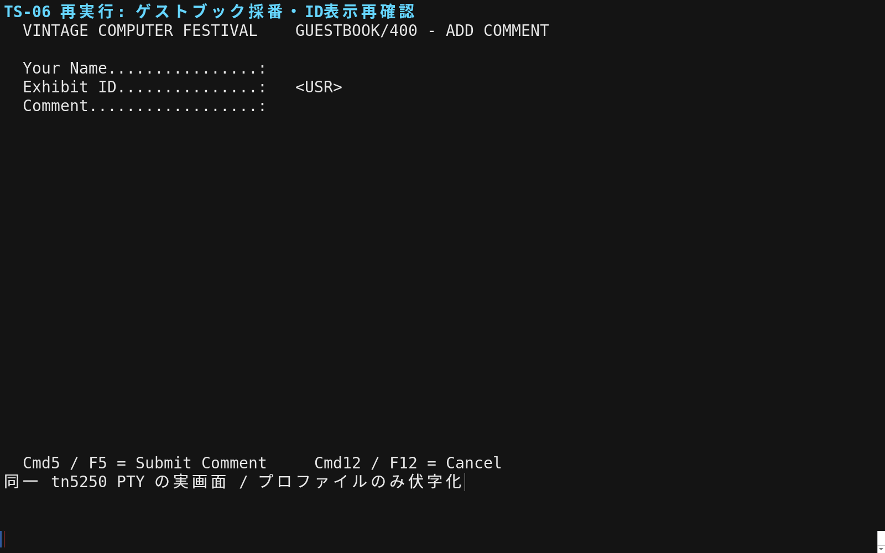
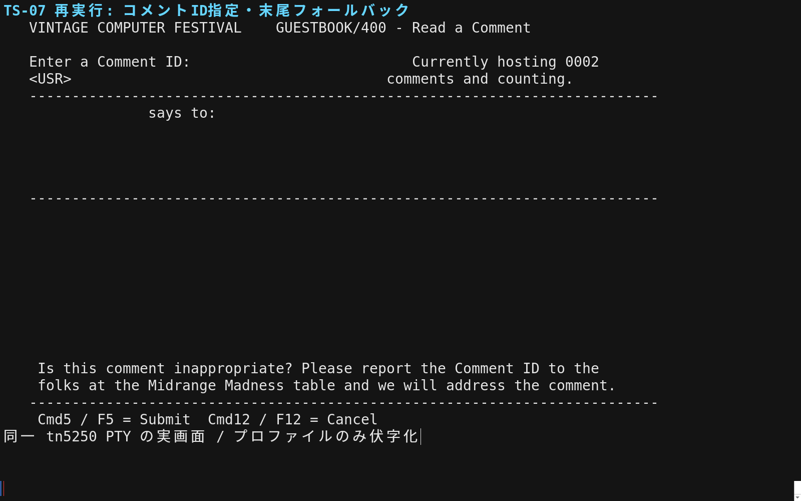
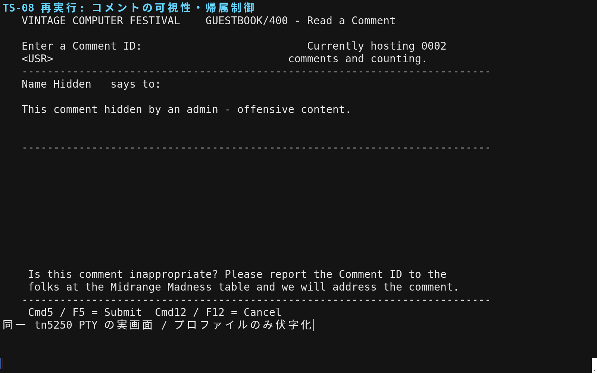
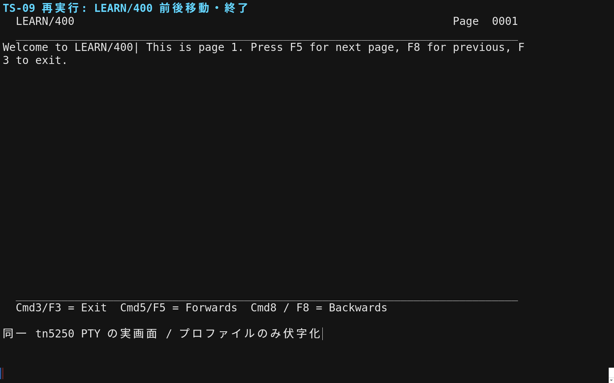
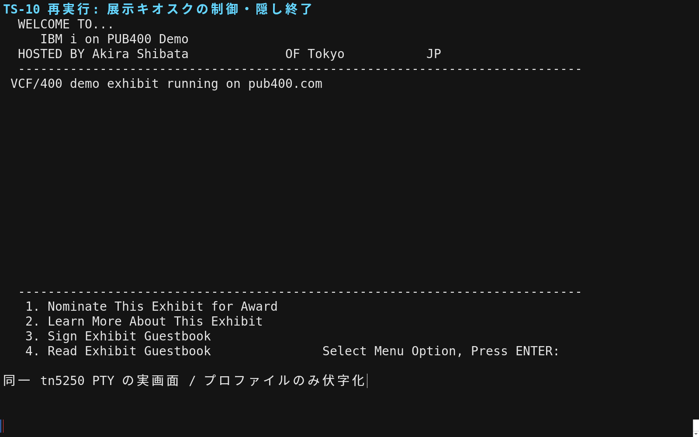

# VCF400 PUB400 実機 E2E テストレポート (10 基本機能)

- 対象: madmerger/VCF400 の RPG/CL/DDS を PUB400 (pub400.com) の検証用ライブラリ `<USR>2` へソースビルドしたもの
- 実行環境: 実 PUB400 / 同一 tn5250 PTY / vt100 / map=37 / 再実行日時 UTC: 2026-11-17T17:28:54.093230+00:00 ～ 2026-11-17T17:45:06.447131+00:00（Devin E2E テスト機能が GUI 端末上の同一 tn5250 セッションを操作、録画あり）
- シナリオ根拠: DeepWiki (madmerger/VCF400) + AGENTS.md の業務ルール（`test_scenarios.md` / `cases.json`）
- 照合ルール: ! → | のコードページ差のみ照合時正規化。プロファイルは <USR> に伏字。

## 1. サマリー

| 項目 | 結果 |
|---|---|
| ソースビルド: オブジェクト | expected=61 found=61 missing=0 |
| ソースビルド: RPG コンパイル | expected=18 severity00=18 failed=0 |
| E2E シナリオ | **10/10 PASS**（43 ステップ） |
| 実 DB before/after 照合 | TS-02, TS-03, TS-04, TS-05, TS-06 |
| 後処理 | reset PASS / サインオフ PASS（最終ダンプは初期状態と一致） |
| 動画 | `video/PUB400_RPG_TS01-TS10.mp4`（9 分 15 秒） |

## 2. ケース別結果

| ID | 基本機能 | DeepWiki 根拠 | ステップ | 結果 |
|---|---|---|---|---|
| TS-01 | メインメニュー VCFMAIN 表示とメニュー遷移 | 3.2 | 4 | **PASS** |
| TS-02 | 投票: 入力必須チェック | 4.1 | 5 | **PASS** |
| TS-03 | 投票: 正常登録 | 4.1 | 2 | **PASS** |
| TS-04 | 投票: 業務チェック (重複/資格外/展示なし/アワードなし) | 4.1 | 7 | **PASS** |
| TS-05 | 投票: 投票期間終了 (ALWVOTE='N') | 4.1 | 2 | **PASS** |
| TS-06 | ゲストブック記入 (入力チェック + CMTID 採番) | 5 / 5.1 | 5 | **PASS** |
| TS-07 | ゲストブック閲覧 (ID 指定 / 末尾超え) | 5 / 5.2 | 4 | **PASS** |
| TS-08 | ゲストブック閲覧の可視性・帰属制御 | 5.2 | 3 | **PASS** |
| TS-09 | LEARN/400 ページ送り (F5/F8/END/F3) | 6 / 6.1 | 5 | **PASS** |
| TS-10 | 展示キオスク EXHBMENU (機能ゲーティング + 隠しオプション 7) | 3 / 3.1 | 6 | **PASS** |

## 3. 観察事項・制約

- **Sev 3** TS-06: 今回の再実行でも ENDCMT の Your Comment ID Is: の後ろが空欄となり再現。実 DB では CMTID=3 で正しく保存。 登録は完了するが、完了画面から採番値を知れない軽微な UX 不備。
- TS-03 / TS-05 / TS-06 / TS-09: map=37 の ! が |、ASCII アートのバックスラッシュ等が M-V / ] 等として表示。 照合時は ! と | のみ同一視。ASCIIアートは合否判定対象外。業務テキスト・タイトルは原文照合。
- 環境: 前回の放置済み接続はホスト応答がなかったため録画前に閉じ、新たな TERM=vt100 の tn5250 で認証。メニュー全24行表示を確認後、今回の全10ケースをその同一セッションで再実行。
- 環境: 各ケース前と終了時は tools/pub400_db.sh reset を直接実行（計11回）。DB dump は ~/p400 ControlMaster を使い6表を1接続で取得し、データ行フィルターを使用しない。展示説明の pub400.com を含むデータ行も保存。
- 環境: TS-02 step5 の初回撮影時はホスト応答前だったため、追加キーなしでメニュー復帰を待って撮影し直した。以降は期待テキストの到着を待って証跡を保存。
- 未検証: CALL/JUMP 分岐・管理メニュー・印刷スプール等は今回の正本10シナリオに含まれず未検証。

## 4. ステップ詳細

### TS-01 メインメニュー VCFMAIN 表示とメニュー遷移 — PASS

| # | 操作 | 期待 | 判定 | 証跡 |
|---|---|---|---|---|
| 1 | GO <USR>2/VCFMAIN | `AS/400 DEMO MENU` / `WELCOME TO...` / `V I N T A G E  C O M P U T E R  F E S T I V A L` / `11. Nominate Exhibit for Award` / `12. Sign Exhibit Guestbook` / `13. Read a Guestbook Comment` / `80. Sign Off the System` / `90. Start Admin Menu` | **PASS** | results/screens/TS-01_step1.txt, screenshots/TS-01_step1.png |
| 2 | 11 + Enter | `VCF/400 - How to Navigate` | **PASS** | results/screens/TS-01_step2.txt, screenshots/TS-01_step2.png |
| 3 | Enter | `NOMINATE EXHIBIT FOR AWARD` | **PASS** | results/screens/TS-01_step3.txt, screenshots/TS-01_step3.png |
| 4 | F12 | `AS/400 DEMO MENU` | **PASS** | results/screens/TS-01_step4.txt, screenshots/TS-01_step4.png |

### TS-02 投票: 入力必須チェック — PASS

| # | 操作 | 期待 | 判定 | 証跡 |
|---|---|---|---|---|
| 1 | VCFMAIN 11 → Enter | `NOMINATE EXHIBIT FOR AWARD` / `展示ID=<USR> 保護` | **PASS** | results/screens/TS-02_step1.txt, screenshots/TS-02_step1.png |
| 2 | 全項目空で F5 | `Must enter Award ID` | **PASS** | results/screens/TS-02_step2.txt, screenshots/TS-02_step2.png |
| 3 | バッジ 7001 / アワード空 で F5 | `Must enter Award ID` | **PASS** | results/screens/TS-02_step3.txt, screenshots/TS-02_step3.png |
| 4 | バッジ空 / アワード 1 で F5 | `Must enter badge number` | **PASS** | results/screens/TS-02_step4.txt, screenshots/TS-02_step4.png |
| 5 | F12 | `AS/400 DEMO MENU` | **PASS** | results/screens/TS-02_step5.txt, screenshots/TS-02_step5.png |

- 実 DB 期待: VOTINGDB 2 件のまま → **PASS** — `1         1 <USR>`; `28         2 <USR>`（results/db_TS-02_before.txt, results/db_TS-02_after.txt）

### TS-03 投票: 正常登録 — PASS

| # | 操作 | 期待 | 判定 | 証跡 |
|---|---|---|---|---|
| 1 | VCFMAIN 11 → Enter → バッジ 7001 / アワード 1 で F5 | `Your vote has been RECORDED!` | **PASS** | results/screens/TS-03_step1.txt, screenshots/TS-03_step1.png |
| 2 | Enter | `AS/400 DEMO MENU` | **PASS** | results/screens/TS-03_step2.txt, screenshots/TS-03_step2.png |

- 実 DB 期待: VOTINGDB に (7001,1,<USR>) 追加・計 3 件 → **PASS** — `1         1 <USR>`; `28         2 <USR>`; `7001         1 <USR>`（results/db_TS-03_before.txt, results/db_TS-03_after.txt）

### TS-04 投票: 業務チェック (重複/資格外/展示なし/アワードなし) — PASS

| # | 操作 | 期待 | 判定 | 証跡 |
|---|---|---|---|---|
| 1 | VCFMAIN 11 → バッジ 1 / アワード 2 で F5 | `You have already voted.` | **PASS** | results/screens/TS-04_step1.txt, screenshots/TS-04_step1.png |
| 2 | バッジ 7002 / アワード 9 で F5 | `Award does not exist.` | **PASS** | results/screens/TS-04_step2.txt, screenshots/TS-04_step2.png |
| 3 | F12 → CALL <USR>2/ADDVOTE PARM('MM2024') | `NOMINATE EXHIBIT FOR AWARD` | **PASS** | results/screens/TS-04_step3.txt, screenshots/TS-04_step3.png |
| 4 | バッジ 7002 / 展示 NOVOTE / アワード 1 で F5 | `Exhibit ineligible for award` | **PASS** | results/screens/TS-04_step4.txt, screenshots/TS-04_step4.png |
| 5 | 展示 NOSUCH で F5 | `Exhibit does not exist` | **PASS** | results/screens/TS-04_step5.txt, screenshots/TS-04_step5.png |
| 6 | バッジ 1 / 展示 NOSUCH / アワード 9 で F5 | `Award does not exist.` | **PASS** | results/screens/TS-04_step6.txt, screenshots/TS-04_step6.png |
| 7 | F12 |  | **PASS** | results/screens/TS-04_step7.txt, screenshots/TS-04_step7.png |

- 実 DB 期待: VOTINGDB 2 件のまま → **PASS** — `1         1 <USR>`; `28         2 <USR>`（results/db_TS-04_before.txt, results/db_TS-04_after.txt）

### TS-05 投票: 投票期間終了 (ALWVOTE='N') — PASS

| # | 操作 | 期待 | 判定 | 証跡 |
|---|---|---|---|---|
| 1 | 事前 SQL: ALWVOTE='N' → VCFMAIN 11 → Enter | `The voting period has ended and you can no longer vote.` | **PASS** | results/screens/TS-05_step1.txt, screenshots/TS-05_step1.png |
| 2 | Enter | `AS/400 DEMO MENU` | **PASS** | results/screens/TS-05_step2.txt, screenshots/TS-05_step2.png |

- 実 DB 期待: VOTINGDB 2 件のまま、再シードで ALWVOTE='Y' → **PASS** — `1         1 <USR>`; `28         2 <USR>`（results/db_TS-05_before.txt, results/db_TS-05_after.txt）

### TS-06 ゲストブック記入 (入力チェック + CMTID 採番) — PASS

| # | 操作 | 期待 | 判定 | 証跡 |
|---|---|---|---|---|
| 1 | VCFMAIN 12 → Enter | `GUESTBOOK/400` / `展示ID=<USR> 保護` | **PASS** | results/screens/TS-06_step1.txt, screenshots/TS-06_step1.png |
| 2 | 名前空 / コメント Hello で F5 | `Must enter your name` | **PASS** | results/screens/TS-06_step2.txt, screenshots/TS-06_step2.png |
| 3 | 名前 Devin Tester / コメント空 で F5 | `Must enter a comment` | **PASS** | results/screens/TS-06_step3.txt, screenshots/TS-06_step3.png |
| 4 | 名前 Devin Tester / コメント E2E test run で F5 | `完了画面 ENDCMT` | **PASS** | results/screens/TS-06_step4.txt, screenshots/TS-06_step4.png |
| 5 | Enter | `AS/400 DEMO MENU` | **PASS** | results/screens/TS-06_step5.txt, screenshots/TS-06_step5.png |

- 実 DB 期待: GUESTBKDB CMTID=3, VISIBLE='Y', EXHBID=<USR>, Devin Tester / E2E test run → **PASS** — `1 Y        <USR>  Great exhibit        VCF/400 running on PUB400.`; `2 Y        <USR>  Devin                VCF/400 is running on PUB400.`; `3 Y        <USR>  Devin Tester         E2E test run`（results/db_TS-06_before.txt, results/db_TS-06_after.txt）

### TS-07 ゲストブック閲覧 (ID 指定 / 末尾超え) — PASS

| # | 操作 | 期待 | 判定 | 証跡 |
|---|---|---|---|---|
| 1 | VCFMAIN 13 → Enter | `総コメント数 2` | **PASS** | results/screens/TS-07_step1.txt, screenshots/TS-07_step1.png |
| 2 | ID 空で F5 | `Must enter CommentID` | **PASS** | results/screens/TS-07_step2.txt, screenshots/TS-07_step2.png |
| 3 | ID 0001 | `Great exhib` / `IBM i on PUB400 Demo` / `VCF/400 running on PUB400.` | **PASS** | results/screens/TS-07_step3.txt, screenshots/TS-07_step3.png |
| 4 | ID 9999 | `Devin` / `VCF/400 is running on PUB400.` | **PASS** | results/screens/TS-07_step4.txt, screenshots/TS-07_step4.png |

### TS-08 ゲストブック閲覧の可視性・帰属制御 — PASS

| # | 操作 | 期待 | 判定 | 証跡 |
|---|---|---|---|---|
| 1 | 事前 SQL: ID 2 VISIBLE='N' → VCFMAIN 13 → ID 0002 | `Name Hidden` / `This comment hidden by an admin - offensive content.` | **PASS** | results/screens/TS-08_step1.txt, screenshots/TS-08_step1.png |
| 2 | CALL <USR>2/READGBCMT PARM('DEMO400') → ID 0001 | `This comment is not part of this guestbook.` / `名前・タイトル空欄` | **PASS** | results/screens/TS-08_step2.txt, screenshots/TS-08_step2.png |
| 3 | CALL <USR>2/READGBCMT PARM('MM2024') → ID 0001 | `Great exhib` / `VCF/400 running on PUB400.` | **PASS** | results/screens/TS-08_step3.txt, screenshots/TS-08_step3.png |

### TS-09 LEARN/400 ページ送り (F5/F8/END/F3) — PASS

| # | 操作 | 期待 | 判定 | 証跡 |
|---|---|---|---|---|
| 1 | VCFMAIN 1 | `LEARN/400` / `Welcome to LEARN/400!` | **PASS** | results/screens/TS-09_step1.txt, screenshots/TS-09_step1.png |
| 2 | F5 | `The AS/400 was introduced by IBM in June 1988` | **PASS** | results/screens/TS-09_step2.txt, screenshots/TS-09_step2.png |
| 3 | F8 | `Welcome to LEARN/400!` | **PASS** | results/screens/TS-09_step3.txt, screenshots/TS-09_step3.png |
| 4 | F5, F5 (EXTRA='END') | `AS/400 DEMO MENU` | **PASS** | results/screens/TS-09_step4.txt, screenshots/TS-09_step4.png |
| 5 | VCFMAIN 1 → F3 | `AS/400 DEMO MENU` | **PASS** | results/screens/TS-09_step5.txt, screenshots/TS-09_step5.png |

### TS-10 展示キオスク EXHBMENU (機能ゲーティング + 隠しオプション 7) — PASS

| # | 操作 | 期待 | 判定 | 証跡 |
|---|---|---|---|---|
| 1 | CALL <USR>2/EXHBMENU PARM('<USR>') | `WELCOME TO...` / `IBM i on PUB400 Demo` / `Akira Shibata` / `1. Nominate This Exhibit for Award` / `4. Read Exhibit Guestbook` / `7 は非表示` | **PASS** | results/screens/TS-10_step1.txt, screenshots/TS-10_step1.png |
| 2 | 7 → WRONGPW | `キオスクに戻る` | **PASS** | results/screens/TS-10_step2.txt, screenshots/TS-10_step2.png |
| 3 | 7 → VCF2024 | `キオスク終了` | **PASS** | results/screens/TS-10_step3.txt, screenshots/TS-10_step3.png |
| 4 | CALL <USR>2/EXHBMENU PARM('NOVOTE') | `Ineligible test exhibit (ELIGIBLE=0)` / `オプション 1・2 非表示、3・4 のみ` | **PASS** | results/screens/TS-10_step4.txt, screenshots/TS-10_step4.png |
| 5 | 1 | `キオスクのまま` | **PASS** | results/screens/TS-10_step5.txt, screenshots/TS-10_step5.png |
| 6 | 7 → VCF2024 | `キオスク終了` | **PASS** | results/screens/TS-10_step6.txt, screenshots/TS-10_step6.png |

## 5. 成果物

- `test_scenarios.md`
- `cases.json`
- `results/results.json`
- `results/screens/`
- `screenshots/`
- `results/db_*.txt / *_reset.log`
- `video/PUB400_RPG_TS01-TS10.mp4`
- `build/ (build.log, verify.txt, listings)`
- `tools/`
